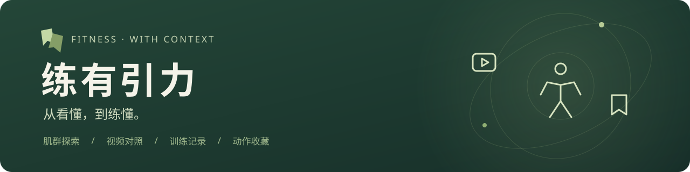
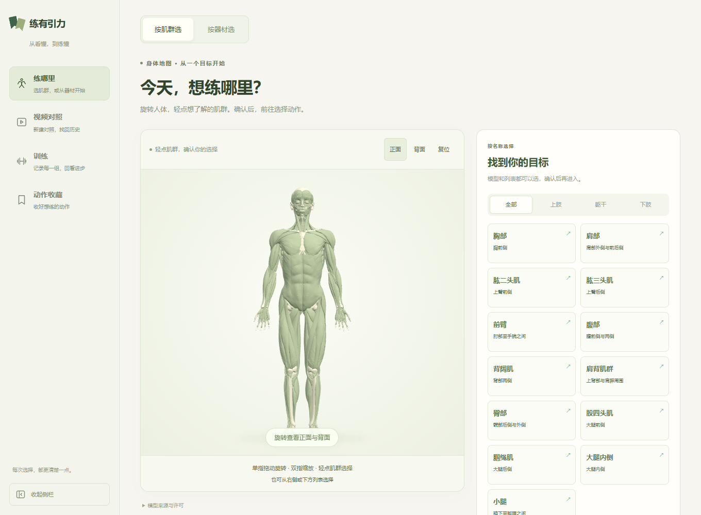
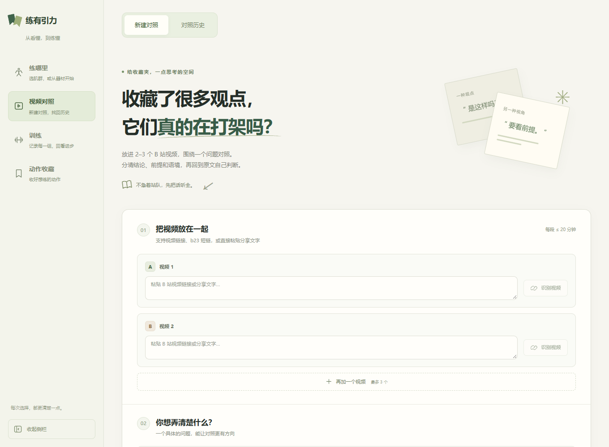
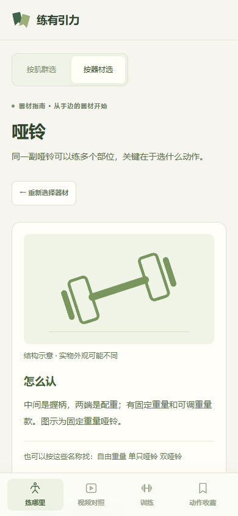
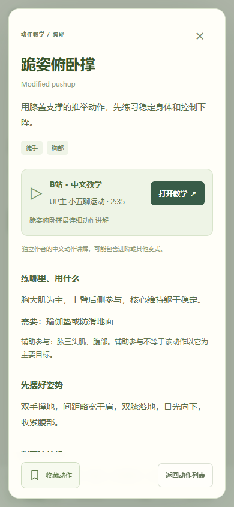
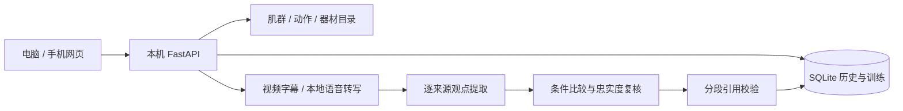

<div align="center">



**一个把健身视频、动作教学和训练记录连起来的个人健身网页。**

选清楚练哪里 · 看明白建议的条件 · 记下真正练过的每一组

[功能介绍](#功能介绍) · [界面预览](#界面预览) · [本地部署](#本地部署) · [手机访问](#手机访问) · [使用指南](#使用指南) · [常见问题](#常见问题)

</div>

---

## 功能介绍

健身时经常遇到两个问题：知道自己想练，但不知道从哪个动作开始；收藏了一堆视频，却发现不同作者的建议听起来互相矛盾。

**练有引力**把这两条路径放进一个网页：从肌群或器材找到动作，也可以把视频放在同一个问题下对照，最后把想练的动作收藏起来、记录训练。

| 入口 | 可以做什么 |
| :--- | :--- |
| **练哪里** | 旋转3D人体、点击并确认肌群，或按器材找动作；查看步骤、常见错误和教学视频 |
| **视频对照** | 输入2–3条B站视频与一个问题，对照观点、目标、适用人群和限制，展开原句、时间与前后文 |
| **训练** | 手动选择动作，记录重量、次数与完成组；保存后回看历史、上次表现和本次小结，使用组间计时 |
| **动作收藏** | 收好想练的动作，电脑与手机读取同一服务里的收藏，再从收藏开始训练 |

当前收录 **13个肌群、16个代表动作、6类器材指南**。手机使用底部菜单，电脑使用可收起的左侧菜单。

**遇到问题直接打开“帮助与说明”**：电脑入口在侧栏下方，手机入口在右上角。支持搜索与分类，涵盖操作步骤、字幕与引用、保存失败、额度暂停、远程访问和备份；关闭帮助后回到当前页面，填写中的内容保留。

> 肌群浏览、动作教学、收藏和训练记录无需调用模型。视频对照使用本机已登录的官方 Codex CLI；字幕缺失时在本地转写音频。

## 界面预览

### 选一个肌群，从身体地图开始



### 把视频放在同一个问题下看



<table>
  <tr>
    <th width="50%">从器材找到动作</th>
    <th width="50%">在手机上查看教学</th>
  </tr>
  <tr>
    <td align="center"></td>
    <td align="center"></td>
  </tr>
</table>

截图来自实际运行页面；仓库不包含个人训练记录或对照数据库。

## 本地部署

**以下步骤面向 Windows 10/11，使用 PowerShell。** 启停和手机访问入口已在 Windows 验证；其他系统暂未提供同等的启动脚本。

### 1. 准备环境

| 依赖 | 用途与要求 |
| :--- | :--- |
| [Git](https://git-scm.com/downloads) | 下载与更新仓库 |
| [Python](https://www.python.org/downloads/) | 使用 **3.12**，安装时启用命令行入口 |
| [Node.js](https://nodejs.org/en/download) | 建议22或24，用于构建网页；仓库包含 npm 锁文件 |
| [FFmpeg](https://ffmpeg.org/download.html) | 添加到 `PATH`，用于解码与转写视频音频 |
| [官方 Codex CLI](https://learn.chatgpt.com/docs/codex/cli) | 视频对照需要；使用本人具有相应 Codex 权限的 ChatGPT 账号登录 |
| [Tailscale](https://tailscale.com/download) | 可选；需要手机远程访问时安装 |

安装后，重新打开 PowerShell，检查命令是否可用：

```powershell
python --version
node --version
npm.cmd --version
git --version
ffmpeg -version
```

### 2. 下载并安装依赖

在你希望存放项目的目录执行：

```powershell
git clone https://github.com/JichaoChen1123/favorite-clash.git
cd favorite-clash

python -m venv .venv
.\.venv\Scripts\python.exe -m pip install -r requirements.lock.txt

cd frontend
npm.cmd ci
npm.cmd run build
cd ..
```

安装过程需要下载 Python 与前端依赖。后续首次处理无字幕视频时，还可能下载本地语音模型；不需要在网页里配置数据库。

### 3. 登录模型服务

按[官方安装说明](https://learn.chatgpt.com/docs/codex/cli)安装 Codex CLI。安装完成后执行：

```powershell
codex login
codex login status
```

在浏览器中使用 **Sign in with ChatGPT** 完成授权。登录方式见 [OpenAI 官方认证文档](https://learn.chatgpt.com/docs/auth)。

当前启动入口配置为 **`gpt-6.1-sol` / `high`**，优先使用桌面应用附带的官方 CLI。本机已验证此接入；其他账号能否使用对应模型，取决于账号权限与 CLI 版本。启动时显示已登录，不等于每一次分析都会成功。

如需明确指定已安装的官方原生可执行文件，在当前 PowerShell 中设置路径，再从同一窗口启动：

```powershell
# 将此示例路径改为你电脑上实际的 codex.exe 路径
$env:CODEX_BINARY = 'C:\Tools\Codex\codex.exe'
& $env:CODEX_BINARY login
& $env:CODEX_BINARY login status
```

网页不要求输入 API Key。视频文字与问题会通过本机 CLI 发给模型；订阅有使用额度，不提供无限调用。

### 4. 启动网页

在项目根目录执行，或直接双击对应文件：

```powershell
.\launchers\start.cmd
```

浏览器打开 **[http://127.0.0.1:8787](http://127.0.0.1:8787)**。启动窗口关闭后，后台仍会运行。

| 日常操作 | 入口 |
| :--- | :--- |
| 启动应用 | `launchers/start.cmd` |
| 停止后台 | `launchers/stop.cmd` |
| 开启手机访问 | `launchers/enable-mobile.cmd` |
| 备份记录 | `launchers/backup-history.cmd` |
| 额度恢复后，手动解除分析暂停 | `launchers/resume-analysis.cmd` |

电脑重启后重新运行 `start.cmd`；当前没有配置开机自动启动。应用只监听本机回环地址。

<details>
<summary><b>部署后自检：页面能开，但模型是否就绪？</b></summary>

在 PowerShell 中执行：

```powershell
Invoke-RestMethod http://127.0.0.1:8787/api/health
```

- `status: ok`：后台正在响应。
- `provider_ready: true`：CLI登录状态检查通过，不代表已完成真实生成测试。
- `ffmpeg_ready: true`：后台可以找到 FFmpeg。

如果刚添加环境变量或安装 FFmpeg，停止并重启应用，使后台读取新环境。

</details>

## 手机访问

手机不必在电脑旁边，也不必连接同一个 Wi-Fi。**电脑保持开机、联网和唤醒，电脑与手机连接同一个 Tailscale 私人网络即可。**

1. 电脑、手机安装 Tailscale，并登录同一账号。
2. 在电脑运行 `launchers/enable-mobile.cmd`。
3. 首次启用时，按提示在 Tailscale 账号页面开启 HTTPS，再重新运行入口。
4. 运行 `launchers/stop.cmd`，再运行 `launchers/start.cmd`，加载允许访问的域名。
5. 手机保持 Tailscale 已连接，在浏览器打开脚本显示的 `https://你的设备名.你的网络.ts.net` 地址。

建议关闭手机 Wi-Fi，用移动网络确认页面、历史与证据可打开，再尝试一次操作。

这里使用 [Tailscale Serve](https://tailscale.com/docs/reference/tailscale-cli/serve) 提供私人 HTTPS 访问。若网络里还有其他成员，请在 Tailscale 管理后台将访问规则限制到自己的设备。仓库不提供公共在线演示地址。

## 使用指南

### 练哪里 → 找动作 → 收藏

1. 在首页拖动人体模型旋转，轻点目标肌群。
2. 在确认窗口核对肌群，点击“确认，进入…”进入独立动作页；选错可重新选择。
3. 按徒手、哑铃或固定器械筛选动作，打开教学详情。
4. 阅读准备步骤、动作要点与常见错误，点击“打开教学”查看B站视频，喜欢的动作可以收藏。

也可以切到“按器材选”，按名称、别名搜索器材，查看怎么辨认、使用前怎么调整，以及对应动作。

人体模型首次约加载6MB。加载慢时点“先从列表选择”；浏览器无法显示3D时，也可通过中文列表完成选择。

### 视频对照 → 核对证据 → 回看历史

1. 进入“视频对照”，粘贴B站链接或分享文字，分别点击“识别视频”。合集必须选择对应分P。
2. 输入一个具体问题，例如：**“这两个视频对深蹲膝盖超过脚尖的建议有什么不同，分别有什么前提？”**
3. 点击“开始对照”，等待获取内容、字幕或转写、观点提取与比较。
4. 先看结论预览和分类，再展开主题卡查看各来源的观点、条件和限制。
5. 展开“查看依据”和“前后文”，点击时间跳回原片。可以标记“比较有误／引用不准确”，也可在“对照历史”重新打开。

| 分类 | 表达的意思 |
| :--- | :--- |
| 基本一致 | 围绕同一问题，主张相容 |
| 条件不同 | 人群、目标或适用条件的差别解释了部分差异 |
| 同条件分歧 | 已明确的关键条件相同，主张仍不相容 |
| 证据不足 | 缺少相关观点或关键条件，暂不能判断 |
| 讨论不同 | 实际讨论的不是同一个问题 |

**每次2–3个不同视频或分P，每段不超过20分钟。** 优先使用字幕，缺失时通过 Faster Whisper 在本机转写；CPU转写和多步模型处理可能需要数分钟。切换手机应用或关闭网页后，后台任务继续，可从历史找回。

无法获取内容时会保留已完成的文字，支持上传对应分P的 UTF-8 SRT、VTT或JSON字幕，单文件不超过2MB，再手动重试。

AI归纳与原文引用分开展示。引用的文字、时间和链接从实际保存分段读取；机器转写仍可能有错字、遗漏，重要内容应回原片复听。此功能比较材料中的说法，不验证科学共识，也不分析视频画面动作。

### 训练 → 记录每组 → 回看上次

1. 进入“训练”，从收藏或动作库选择动作，开始一次训练。
2. 填写每组重量与次数。哑铃记单只重量，器械按标注，徒手可记0kg。
3. 手动保存；勾选完成组后会自动保存，保存成功才开始休息计时。
4. 训练中可以点动作名称看教学，关闭后返回；切换菜单保留当前草稿和计时。
5. 完成后结束并保存，查看动作数、完成组与记录时长；历史可回看，下次可参考上次已完成表现。

保存失败时保留当前输入。若提示“保存未确认”，先核对记录，再决定重试；重新读取会替换未保存修改，页面会先确认。刷新或关闭前请先保存。

组间计时默认90秒，可调15–600秒，支持暂停与继续。计时保存在当前浏览器，不提供锁屏提醒。记录时长包含休息，不等同实际运动时长。

## 数据与备份

| 位置 | 内容 |
| :--- | :--- |
| `data/favorite-clash.sqlite3` | 视频任务、字幕、结果、反馈、运行配置、收藏、训练记录与额度暂停状态 |
| `.cache/whisper-models/` | 本地语音模型缓存，可复用 |
| `.runtime/` | 后台状态、私人访问配置和诊断日志 |
| `backups/` | 通过完整性检查的独立数据库快照 |

双击 `launchers/backup-history.cmd` 即可备份，后台运行时也可执行。备份包含历史、收藏、训练和暂停状态，不包含音视频缓存、程序依赖与账号凭据；具体检查结果在备份目录的 `backup-report.json`。

程序更新前先备份，再停止后台、拉取代码并重建前端：

```powershell
.\launchers\backup-history.cmd
.\launchers\stop.cmd
git pull --ff-only
.\.venv\Scripts\python.exe -m pip install -r requirements.lock.txt
cd frontend
npm.cmd ci
npm.cmd run build
cd ..
.\launchers\start.cmd
```

本地数据、缓存、账号文件和备份不进入 Git 仓库。不要删除 `data/` 来处理普通页面错误。

## 常见问题

<details>
<summary><b>页面能打开，但点击分析失败</b></summary>

检查 `codex login status`、默认模型权限、CLI版本和电脑网络；如指定了 `CODEX_BINARY`，用同一可执行文件检查登录。旧全局CLI可能无法识别当前配置模型，可以明确指定已验证的官方原生CLI。

`provider_ready`只检查登录状态。页面会区分登录、接入、超时和格式问题；后台日志位于 `.runtime/server.stderr.log`。

</details>

<details>
<summary><b>模型额度不足怎么办？</b></summary>

应用会暂停后续分析，保留字幕与历史；暂停状态在重启后仍保留。确认额度恢复并决定继续后，运行 `launchers/resume-analysis.cmd`，再回网页手动重试。

解除暂停不会自动处理旧任务，也不会购买额度、使用重置额度或切换服务。

</details>

<details>
<summary><b>没有字幕，或本地转写很慢</b></summary>

确认 FFmpeg 可用；首次转写可能还在下载语音模型。默认使用 `small`，加载失败时有 `tiny` 后备，中文识别质量可能下降；可在后台环境设置 `WHISPER_MODEL` 为本地模型目录。

已有对应字幕时，可在任务页直接上传。链接失效、登录限制、音频无法获取等情况会显示原因，不会用生成文字冒充视频内容。

</details>

<details>
<summary><b>手机访问不了，或者出现“暂时连接不上服务”</b></summary>

先确认电脑没有休眠、本机网页可打开，再确认两端 Tailscale 已连接。开启私人域名后需要重新启动应用；终端若出现启用HTTPS的链接，完成授权后再运行手机入口。

如果电脑本机也打不开，运行 `start.cmd`，并检查 `.runtime/server.stderr.log`。网络恢复后可在页面手动刷新；历史读取失败不会代表记录被删除。

</details>

<details>
<summary><b>B站视频在应用内置浏览器里打不开</b></summary>

可以在系统浏览器打开同一教学链接。视频仍由B站提供，播放与跳转受其浏览器兼容性、登录状态和访问规则影响。

</details>

<details>
<summary><b>支持自动整周计划、器材拍照和热量记录吗？</b></summary>

当前提供手动训练记录。自动整周计划、器材拍照识别、热量与摄入记录属于后续范围，尚未开放。

</details>

## 技术结构

| 层 | 技术 |
| :--- | :--- |
| 页面与交互 | React 19 · TypeScript · Vite · Three.js |
| 服务与存储 | FastAPI · Pydantic · SQLite |
| 视频内容 | B站字幕 · yt-dlp · FFmpeg · Faster Whisper |
| 文本分析 | 官方 Codex CLI · JSON Schema · 服务端结构与引用校验 |
| 远程访问 | 本机回环服务 · Tailscale Serve |



模型只接收问题与材料，不执行工具。观点引用使用已保存分段编号关联，原句、时间和跳转由程序读取；没有向量数据库或全站检索。

<details>
<summary><b>开发检查与可选配置</b></summary>

在根目录运行本地测试；以下检查本身不需要发起真实模型生成：

```powershell
.\.venv\Scripts\python.exe -m pytest -q -p no:cacheprovider
node frontend/qa/audit-api.mjs
node frontend/qa/audit-muscles.mjs
node frontend/qa/audit-equipment.mjs
node frontend/qa/audit-training.mjs
```

需要前端实时开发时，开两个终端。后端使用独立数据目录，避免开发测试污染日常记录：

```powershell
# 终端一：项目根目录
$env:CLASH_DATA_DIR = Join-Path (Get-Location) '.runtime/dev-data'
.\.venv\Scripts\python.exe -m uvicorn app.main:app --host 127.0.0.1 --port 8000
```

```powershell
# 终端二：项目根目录
cd frontend
npm.cmd run dev
```

Vite开发页默认在 `http://127.0.0.1:5173`，将 `/api` 转发至本机8000端口。常规部署仍使用构建后页面与8787端口。

| 环境变量 | 说明 |
| :--- | :--- |
| `CODEX_BINARY` | 显式指定官方原生CLI，优先级最高 |
| `CLASH_MODEL_TIMEOUT` | 单次模型调用等待秒数，默认300，限制30–600 |
| `WHISPER_MODEL` | 模型名或本地目录；启动器优先使用已缓存的small模型 |
| `ASR_TIMEOUT_SECONDS` | 本地转写上限，默认900秒，范围30–1800 |
| `CLASH_ALLOWED_HOSTS` | 额外允许的主机名；手机入口自动保存并在启动时加载 |
| `BILI_COOKIE_FILE` | 可选，本人会话的本地Netscape格式cookies文件；不要提交 |

Windows启动器固定分析模型与推理强度，并设置项目内的数据、缓存和私人域名；直接运行后端的开发环境请按需显式配置。接口结构见 [API_CONTRACT.md](docs/API_CONTRACT.md)。

</details>

## 来源与许可

- 视频字幕优先与音频转写流程参考并改编自 [BiliNote](https://github.com/JefferyHcool/BiliNote)。上游版本与使用范围见 [UPSTREAM.md](docs/UPSTREAM.md)，保留[原MIT许可](third_party/BiliNote-LICENSE)。
- 人体模型来自 [Charleeh / Écorché](https://github.com/Charleeh/ecorche)，采用 **CC BY-SA 4.0**，基于 BodyParts3D（DBCLS）与 Z-Anatomy（Gauthier Kervyn）。模型原文件保留，页面增加中文归组、配色与交互；查看[完整署名](frontend/public/models/ecorche/ATTRIBUTION.md)与[版本记录](docs/ANATOMY_ASSET.json)。
- Three.js与Meshoptimizer的许可保留在 [licenses](frontend/public/licenses)。动作文字资料和B站教学视频分别标注来源，视频由原平台播放。

---

<div align="center">

**让每一次训练，都有引力。**

原文有出处 · 判断有余地

</div>
